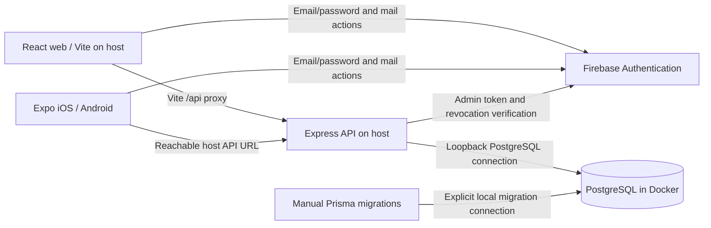
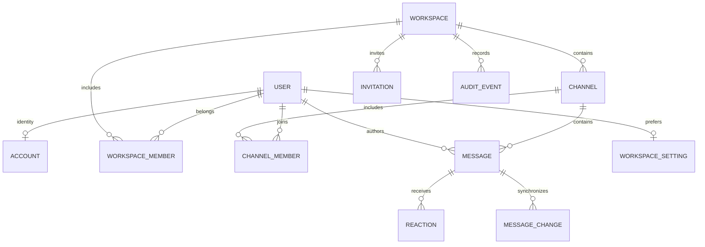

# Fable architecture

Updated: 20 October 2026. This document describes the implemented application, its invariants and the deployment boundaries. Read `GEMINI_HANDOFF.md` for the remaining release work and detailed feature implementation plans. `AGENTS.md` contains the engineering rules and the user's no-CI/no-test-files preference.

## 1. Product and release boundary

Fable is a workspace collaboration application with public/private text rooms, searchable message history, reactions, pins, profiles and workspace administration. The web and Expo clients share Firebase identity in production, an optional local development identity, and a PostgreSQL-backed API. The latest visual direction follows an Apple Messages-inspired two-column messenger: one chat list, a wide conversation, neutral light/dark surfaces and blue outgoing bubbles. Instrument Serif remains on wordmarks; signed-in conversation text, controls and metadata use system fonts. The web app fills the browser edge to edge with compact spacing, a single-pane phone layout and keyboard-aware viewport sizing. UI language uses chats, people and groups; existing workspace/channel API identifiers and authorization remain unchanged. See `DESIGN.md` for layout, tokens and interaction rules.

The public web landing is available at `/welcome` independently of session loading/errors and at `/` for anonymous visitors. Signed-in `/` still opens `/app`. Its lazy-loaded component and scoped stylesheet provide a separate editorial marketing design, original vector artwork and a keyboard-accessible capability tour. The local licensed Instrument Serif font is now declared/preloaded globally on web and bundled/loaded through the existing Expo Font module on native, for consistent branding and conversation text. Tour illustrations are explicitly labeled and do not contain fabricated application records. CTAs use the existing signup/login/app routes.

The messaging expansion adds private direct conversations, quoted replies, emoji input, expiring typing indicators, read receipts, protected attachments, voice recording/playback and foreground one-to-one WebRTC calling. Calls are available from direct conversations; group calls, background ringing and push delivery remain unfinished. Source implementation and real device verification are separate statuses. See `FEATURE_PARITY.md` for the complete current scope and manual walkthrough.

The latest iMessage-style direction uses system typography inside signed-in conversations, neutral received bubbles, blue outgoing bubbles, emoji sizing and reduced-motion-aware message entrances. The landing and brand keep Instrument Serif. This supersedes the earlier conversation-font direction below and in historical handoff entries.

### Local-first messaging additions — 20 October 2026

- Direct conversations reuse private channels with a unique hash of workspace and participant pair. Both participants must belong to the workspace. They cannot be renamed, transferred or expanded through room-management endpoints. The public DTO exposes `isDirect` and the other participant's real name, never the pair key. Conversation directories now order by last message time with an ID tie-breaker, and display real last-message previews. As with a changing feed, a conversation that moves between pages may require refreshing the first page.
- `Message.replyToId` references a message in the same authorized conversation, validated under the room lock. Quotes use the retained message window; older parents are labeled **Earlier message**. Full thread views and cross-window quote navigation remain pending. Message creation fingerprints include reply/media IDs only when supplied, preserving existing text-send idempotency keys.
- `ChannelMember.typingUntil` expires after six seconds. Both clients throttle typing writes and poll status every four seconds only while active. Receipts count explicit, persisted read watermarks for current workspace participants. **Sent** means server acceptance; **Read** means a real read watermark. Device delivery is not fabricated. Read-receipt privacy preferences are pending.
- `MediaAsset` stores bounded binary bytes in PostgreSQL with channel, owner and optional message scope. `POST /api/media/:channelId?name=...` accepts an authenticated octet stream up to 10 MiB. Uploads are drafts; `attachmentIds` are bound atomically during message creation. Maximum four attachments per message and 100 MiB per uploading account. Only that account can read an unbound upload. Authorized participants can read attached media. Deleting the message removes its media bytes. Abandoned uploads older than 24 hours are reclaimed on that account's next upload, rather than by a durable worker.
- Media types are recognized from signatures. SVG/HTML/unknown files download as octet streams. Downloads require authorization headers, use attachment disposition and never put tokens in URLs. Both conversation views retain one open media preview; native streams a chosen file into its cache and removes it when the preview unmounts. Native composer upload buffering is bounded to one 10 MiB file; streaming uploads, image resizing and public-hosting malware controls remain future hardening.
- Browser voice recording uses a bundled AudioWorklet to resample actual microphone audio to mono 16 kHz PCM WAV, capped at two minutes. Native uses Expo Audio's M4A recording. This avoids requiring an external transcoder for browser voice notes on iOS. File choosing uses the OS picker. Native video uses Expo Video and file export uses Expo Sharing. Recording, codec compatibility and audio focus still require physical device verification.
- `Call` stores participant IDs, a bounded SDP offer/answer, status and heartbeat leases. `POST /api/calls`, `/api/calls/:id` actions, `/api/calls/incoming` and `/api/calls/config` authorize the participant and current private conversation. Sorted per-user advisory locks reject competing calls. Ringing expires after 60 seconds; stale participants after 45 seconds; accepted calls have a two-hour cap. SDP is purged when an end/expiry is processed. Expiry is processed on participant API activity; unattended retention cleanup is still pending. Media flows directly through WebRTC, rather than through Express or PostgreSQL.
- `WEBRTC_ICE_SERVERS=[]` defaults to local-network peers. Add operator-owned STUN/TURN settings in `backend/.env` for other networks. TURN credentials delivered to clients must be treated as client-visible; a public deployment should supply short-lived credentials. There is no paid provider or additional container. Browser capture requires localhost or HTTPS. Native uses `react-native-webrtc` and its Expo config plugin; it needs a rebuilt native binary. Expo Go remains usable for messaging. Native calls explicitly stop on backgrounding; CallKit/Android telecom integration and push credentials are not configured.

Four additive migrations (`202610200001_messenger_core`, `202610200002_local_media`, `202610200003_conversation_order`, `202610200004_media_retry`) were deployed to the verified local `fable_development` schema after a full local database backup. The fourth adds an actor/conversation/content digest to reconcile lost upload responses without consuming quota twice; both clients deduplicate returned draft IDs. The database volume and legacy public schema were preserved. No API containers, test files or CI workflows were added.

The current setup runs PostgreSQL in Docker and starts the API, web and Expo clients manually with npm. Production readiness is not signed off: actual Firebase email delivery, populated migration verification, dependency review, future public hosting and native release/device checks remain. Local builds do not establish those external outcomes.

## 2. Implemented stack

| Layer           | Current implementation                                             | Target/constraint                                                                                    |
| --------------- | ------------------------------------------------------------------ | ---------------------------------------------------------------------------------------------------- |
| Web             | React 19, TypeScript, React Router, Vite 6, Tailwind 4             | Preserve strict types and real API behavior.                                                         |
| Mobile          | Expo SDK 57, React Native 0.86, React 19.2.3, Expo Router          | Keep SDK-compatible native dependencies; build both Android and iOS.                                 |
| API             | Express 4, TypeScript, Zod, Firebase Admin, Prisma 6               | Keep the existing backend and its verified contracts.                                                |
| Data            | PostgreSQL 16 in Docker                                            | Named persistent volume, loopback host access and reviewed migrations. Neon remains a future option. |
| Auth            | Firebase Email/Password; optional local development identity       | Production requires verified Firebase identities. Development can explicitly skip Firebase.          |
| Running locally | Docker database; manually started Express, Vite and Expo processes | One Compose file. No API/web containers, GitHub workflows or checked-in tests.                       |

The exact installed versions come from the committed package lockfiles. The user explicitly chose to keep Fable's Express/Prisma backend. The FastAPI architecture in the reusable `AGENTS.md` template is not a migration requirement for this project. Document and extend the actual TypeScript/Express service; do not add a replacement Python backend.

## 3. System boundaries



Firebase owns credentials, password policy, ID/refresh tokens, verification emails and password-reset emails. PostgreSQL owns application profiles, workspace membership, room membership and all business records. Clients never receive database connection strings or Admin credentials. No local-password or second application-JWT system exists.

For the hobby deployment, use one API instance and the process-local abuse limiter. Multiple API instances require a shared limiter/edge abuse policy and, if realtime is added, shared event delivery. Do not introduce Redis, Kafka or Kubernetes without a demonstrated requirement.

## 4. Repository ownership and important files

| Path                                                                                     | Responsibility                                                                                                                            |
| ---------------------------------------------------------------------------------------- | ----------------------------------------------------------------------------------------------------------------------------------------- |
| `backend/src/app.ts`                                                                     | HTTP middleware, CORS, request limits, router composition and safe errors.                                                                |
| `backend/src/index.ts`                                                                   | Database connection, HTTP startup, timeouts and graceful shutdown.                                                                        |
| `backend/src/lib/auth.ts`                                                                | Verified Firebase identity, application account and active membership resolution.                                                         |
| `backend/src/lib/access.ts`                                                              | Tenant/room scopes, management permissions and transactional lock helpers.                                                                |
| `backend/src/lib/messages.ts`                                                            | Safe message DTOs and SQL-aggregated reaction summaries.                                                                                  |
| `backend/src/lib/messageHistory.ts`                                                      | Consistent history/pin snapshots and durable replay checkpoints.                                                                          |
| `backend/src/lib/messageMutations.ts`                                                    | Typed edit/delete/pin/reaction transactions and version checks.                                                                           |
| `backend/src/lib/workspaceMembership.ts`                                                 | Departure/revocation safeguards and private-room ownership reconciliation.                                                                |
| `backend/src/routes/workspaceInvitations.ts`, `workspaceMembers.ts`, `channelMembers.ts` | Focused invitation and membership HTTP boundaries.                                                                                        |
| `backend/src/lib/search.ts`                                                              | Scoped full-text message search and query-bound cursors.                                                                                  |
| `backend/src/lib/directory.ts`                                                           | Bounded directory paging/query validation.                                                                                                |
| `backend/src/lib/telemetry.ts`                                                           | Request IDs, response cache protection and redacted structured logs.                                                                      |
| `backend/src/routes/`                                                                    | Actual HTTP contracts described below.                                                                                                    |
| `backend/prisma/schema.prisma`                                                           | Application database model and indexes managed by Prisma.                                                                                 |
| `backend/prisma/migrations/`                                                             | Twelve historical/additive migrations; do not rewrite already deployed history.                                                            |
| `frontend/src/services/`                                                                 | Firebase identity, HTTP transport in `request.ts`, and typed endpoints in `api.ts`.                                                       |
| `frontend/src/components/chat/useChannelMessages.ts`                                     | Bounded message/pin state, foreground polling and confirmed mutations.                                                                    |
| `frontend/src/components/CreateRoomDialog.tsx`                                           | One server-backed room form shared by the modal and empty state.                                                                          |
| `frontend/src/components/`                                                               | Web dashboard, room context, profiles, administration and search.                                                                         |
| `mobile/src/services/`                                                                   | Native/web Firebase adapters, secure persistence, `session.ts` for auth/session scope, `request.ts` for HTTP, and `api.ts` for endpoints. |
| `mobile/src/components/chat/useChannelMessages.ts`                                       | Native message windows, durable replay, pagination and confirmed mutations.                                                               |
| `mobile/src/components/chat/MessageRow.tsx`                                              | Memoized row rendering and its own native styles.                                                                                         |
| `mobile/src/components/`                                                                 | Native dashboard, virtualized chat/directories, management and search modals.                                                             |
| `mobile/src/constants/theme.ts`                                                          | Mobile design tokens; persisted appearance is applied by the client.                                                                      |
| `scripts/check.mjs`                                                                      | Local build/type/lint checks; no test framework or CI runner.                                                                             |
| `scripts/deploy-database.mjs`                                                            | Explicit direct-connection migration deployment.                                                                                          |
| `docker-compose.yml`                                                                     | PostgreSQL only, bound to loopback, with the existing `fable_postgres_data` volume.                                                       |
| `.env.example`, package `.env.example` files                                             | Root variables configure Docker PostgreSQL; package variables configure manually run applications.                                        |
| `mobile/app.config.ts`, `mobile/eas.json`                                                | Configurable owned native identifiers and manual release profiles.                                                                        |

Dashboards compose workspace navigation, settings and dialogs. Chat hooks own the related history/pin windows and concurrency guards; pure message-state helpers reconcile records. Keep those guards together when changing synchronization. Do not replace bounded pages with a global unbounded store. Each source module documents its responsibility; comments explain security, ordering and lifecycle constraints rather than narrating obvious syntax.

Native navigation motion stays outside chat state: `DashboardView` owns one Reanimated shared value and the adaptive drawer width. `NavigationSwipeArea` translates the main surface left; the sibling modal `NavigationDrawer` uses that same value for panel position, scrim and drag dismissal. The modal starts motion on presentation and actions run after dismissal. Do not duplicate the animation state or translate the modal along with its underlying content. This mobile-only presentation change has no API or persistence effect.

## 5. Identity and session lifecycle

Local development can skip Firebase with `DEV_AUTH_ENABLED=true` in `backend/.env`, `VITE_DEV_AUTH_ENABLED=true` in `frontend/.env` and `EXPO_PUBLIC_DEV_AUTH_ENABLED=true` in `mobile/.env`. Restart the API, Vite and Expo after changing these flags. Both clients automatically open the same local account, provisioned through the real `/api/auth/session` transaction. After signing out, the login screen offers **Continue in development**. No Firebase configuration, password, verification email or emulator is needed in this mode.

The server chooses the development identity, defaulting to `developer@fable.local` / `Local developer`; optional `DEV_AUTH_EMAIL` and `DEV_AUTH_NAME` customize it. Its UID is namespaced and derived from its email. Changing the email creates a separate account and workspace; it never takes over an existing Firebase/legacy account. The local profile, workspace, empty general room and subsequent app activity are persisted in PostgreSQL. Existing users and data are preserved, and membership/room authorization still applies. All clients using the same API development identity share that account. The public `fable-development` bearer marker is not a secret or a production credential; use this mode only on a trusted development network. Device-wide revocation is hidden and refused in this mode.

The API refuses `DEV_AUTH_ENABLED=true` unless `NODE_ENV=development`. Production web builds and Expo release bundles always use Firebase, even when a local client development flag is present. Set all three flags to `false` and configure Firebase to restore normal authentication locally; set the API flag to `false` before production startup. Firebase Admin initializes only when Firebase authentication is actually used.

The following flow describes Firebase mode:

Registration uses the Firebase client SDK, updates the real display name, sends a verification email and signs out. An unverified temporary SDK identity never provisions PostgreSQL data. Resending verification signs in temporarily with the entered password, sends the mail and signs out again. Password recovery requests the Firebase reset email and uses its browser action handler.

Login reloads the Firebase user and refuses unverified emails. The client obtains a Firebase ID token and calls `POST /api/auth/session`. The server verifies the configured project, signature, expiry, revocation/disabled status, `email_verified` and password sign-in provider. UID is the application identity boundary. Email matching alone never links legacy accounts.

Initial session provisioning atomically creates an `Account`, `User`, owner `WorkspaceMember`, personal workspace and empty `general` text room. These are records for an actual verified user, not sample data. A unique Firebase UID makes concurrent session creation idempotent. A pre-existing unmatched legacy email yields a deliberate conflict instead of transferring that account silently.

Ordinary logout uses Firebase client sign-out and clears scoped selection/cache state. `POST /api/auth/logout` is an all-device token-revocation endpoint, not a routine per-device logout. Mobile refresh credentials use the existing serialized/chunked SecureStore persistence adapter; its physical Keychain/Keystore lifecycle still requires manual native verification.

Every protected request resolves the current database identity and membership. `X-Workspace-Id` selects an active workspace; otherwise the oldest membership is used. Discovery, workspace create/join and personal account routes deliberately remain recoverable without a workspace or with a stale saved selection. Tenant routes still require actual membership.

## 6. Database and relationships



| Model              | Purpose and important constraints                                                                                                                                  |
| ------------------ | ------------------------------------------------------------------------------------------------------------------------------------------------------------------ |
| `Account`          | Unique email, Firebase UID and user relation. UID can be null only for legacy migration records. No password fields.                                               |
| `User`             | Real profile, unique handle, monogram, status text and expiring presence heartbeat. Public DTO excludes account email.                                             |
| `Workspace`        | Tenant name and lifecycle timestamps. Ownership is represented by membership role.                                                                                 |
| `WorkspaceMember`  | Composite workspace/user primary key; role constrained to owner/admin/member. Directory indexes include creation time and ID ties.                                 |
| `Channel`          | Scoped unique name, topic, text/audio/video type, visibility and creator reference. Workspace cascade is intentional only under an authorized lifecycle operation. |
| `ChannelMember`    | Composite channel/user key, read timestamp and message-ID tie-breaker. Private access depends on actual membership.                                                |
| `Message`          | Author, room, content/code, creation/edit/delete timestamps, version, pin flag and optional client mutation ID/hash.                                               |
| `Reaction`         | Unique message/user/icon; supported icons are constrained. Counts are grouped in SQL.                                                                              |
| `MessageChange`    | Durable bigint change sequence with room/message indexes; serialized writes make room cursors safe.                                                                |
| `Invitation`       | Intended verified email, hashed random secret, seven-day expiry and one-use acceptance. The raw secret is returned only at creation.                               |
| `AuditEvent`       | Workspace, actor, action, target and limited metadata; administrators can inspect bounded pages.                                                                   |
| `WorkspaceSetting` | Despite the historical name, settings are account scoped through a unique user ID. Media fields remain dormant legacy preferences.                                 |
| `LegacyArchive`    | Inaccessible archived historical metadata; no public API or automatic account import.                                                                              |

Database timestamps are `timestamptz(3)` and API dates are UTC ISO strings. Message creation time is immutable. Clients localize display time without changing ordering. Bigint synchronization cursors are serialized as strings. Selected message/pin windows do not limit the accessible history stored on the server.

The eighth migration adds message-create idempotency columns/constraints, an invitation paging index and a partial GIN full-text index on live message content plus code. It preserves existing content. On a large installation, plan the GIN build's write lock or prebuild the index concurrently as documented in the migration. Never assume a schema validation command has deployed that migration.

Earlier migrations baseline the original schema, isolate workspaces, expire presence, convert timestamps, add collaboration controls, handle read ties and add directory indexes. Historic shared rooms are quarantined, not assigned to arbitrary new accounts. Preserve this boundary during future schema changes.

## 7. Permissions and administration

| Operation                                        | Policy                                                                                                |
| ------------------------------------------------ | ----------------------------------------------------------------------------------------------------- |
| Discover/create/join workspaces                  | Provisioned verified identity; invitation email must match.                                           |
| Read public room                                 | Current workspace membership.                                                                         |
| Read private room                                | Current workspace membership plus actual private-room membership. Admin status alone is insufficient. |
| Create text room                                 | Workspace member; creator gets room membership.                                                       |
| Edit/delete room or transfer creator             | Creator or workspace owner/admin with actual room access.                                             |
| Invite/list/revoke invitations, rename workspace | Current owner/admin, rechecked transactionally.                                                       |
| Promote/demote workspace member                  | Owner only; owner role changes through ownership transfer.                                            |
| Remove workspace member                          | Owner; admin may remove an ordinary member, not another admin/owner.                                  |
| Leave workspace                                  | Non-owner with another workspace, after transferring owned rooms.                                     |
| Transfer workspace ownership                     | Owner to another actual workspace member; former owner becomes admin.                                 |
| Edit message                                     | Author of a live, accessible message.                                                                 |
| Delete message                                   | Author or workspace owner/admin with actual room access.                                              |
| Pin/react                                        | Member who can access the live message's room.                                                        |
| Audit history                                    | Workspace owner/admin.                                                                                |

Ownership safeguards distinguish voluntary departure from administrative revocation. Voluntary self-leave requires transferring owned rooms and workspace ownership first. Administrative removal cannot be blocked by a private-room creator: private ownership moves to the earliest remaining actual room participant who still belongs to the workspace, or becomes null if none remains. Public creator references are detached. Messages/privacy are preserved; administrators are never enrolled in the private room. A counts-only reconciliation event is audited. A private room's explicit new creator must already belong to that room. Self-leave cannot strand a user without another membership; an administrator can revoke a person's last membership for security, and that account can then create/join a workspace through recovery paths.

Channel deletion requires the exact room name and removes its message/history relationships according to the schema. It is an actual destructive operation; both clients must show its consequence before submission. Workspace deletion/account deletion are not implemented lifecycle shortcuts.

## 8. Transaction and synchronization invariants

Membership mutations take an exclusive workspace advisory transaction lock. Channel/message mutations take a shared workspace gate followed by the existing channel lock. Actor membership/role is rechecked inside the transaction. Removals across workspaces also serialize per affected user, preventing simultaneous self-leaves from bypassing the last-workspace safeguard. Keep the documented lock order when adding writes.

Deployment must drain old API workers before enabling these new membership operations: old workers do not participate in the new workspace gate. A mixed old/new rollout does not inherit the new race guarantee.

Message mutations serialize by room, increment an integer version and create a durable `MessageChange` in the same transaction. A sequence allocation by itself is not commit ordering; retain the room transaction lock. History and pins capture a checkpoint with their consistent snapshot so edits to old rows can be caught up afterward.

Editing/deleting/pinning requires an expected version; stale writes return 409 and clients retain drafts. No-op edits/pins do not create unnecessary versions/events. Deletion purges content, code/media metadata, reactions and pins while retaining a tombstone ID/time for valid history/read cursors.

Message creates may include `clientMutationId`, unique per room/sender. The stored payload fingerprint makes a retry return the existing record; a conflicting payload using the same key returns 409. Clients keep the key for an uncertain retry and create a new key for a different operation. This is not an offline queue or a license to retry arbitrary mutations.

History uses stable `(createdAt, id)` cursors. `before`, `after` and `around` are mutually exclusive. The `around` window opens an exact search result without marking unrelated unseen live messages read. Pins have independent history pages. Read markers advance monotonically and include an ID tie-breaker; archive browsing does not acknowledge unseen future messages.

## 9. HTTP contracts

Base path: `/api`. Headers: `Authorization: Bearer <Firebase ID token>`, and `X-Workspace-Id` for scoped resources. JSON request bodies are capped at 64 KiB. Failure responses contain `error`; central error responses also include a safe request ID. The `X-Request-Id` response header is available for support without logging user content.

| Endpoint                                                                 | Contract                                                                                              |
| ------------------------------------------------------------------------ | ----------------------------------------------------------------------------------------------------- |
| `POST /auth/session`, `GET /auth/me`, `PATCH /auth/profile`              | Real session/profile DTO `{ user }`; profile accepts name/status text only.                           |
| `POST /auth/logout`                                                      | Revoke all-device Firebase refresh tokens; 204.                                                       |
| `POST /auth/login`, `/auth/register`                                     | Retired local auth, 410; clients use Firebase directly.                                               |
| `GET /workspace`                                                         | User's paged workspaces, roles, total and current selection.                                          |
| `POST /workspace { name }`                                               | New workspace with owner membership and empty general room.                                           |
| `GET/PATCH /workspace/:id`                                               | Membership lookup / owner-admin rename.                                                               |
| `PATCH /workspace/:id/members/:userId { role }`                          | Owner changes admin/member role.                                                                      |
| `DELETE /workspace/:id/members/:userId`                                  | Authorized removal with ownership safeguards.                                                         |
| `POST /workspace/:id/transfer-ownership { userId }`                      | Transfer to existing member.                                                                          |
| `POST /workspace/:id/leave {}`                                           | Protected self-leave; 204.                                                                            |
| `GET/POST /workspace/invitations`                                        | Bounded status listing / email-bound invitation creation.                                             |
| `DELETE /workspace/invitations/:id`                                      | Revoke an unaccepted invite, never expose its secret again.                                           |
| `POST /workspace/join { token }`                                         | Atomic acceptance matching verified email.                                                            |
| `GET /workspace/audit?before=&limit=`                                    | Administrator's reverse chronological bounded audit page.                                             |
| `GET/POST /channels`                                                     | Paged/searchable accessible rooms / real room creation.                                               |
| `GET/PATCH/DELETE /channels/:id`                                         | Actual room / metadata update / exact-name-confirmed deletion.                                        |
| `POST /channels/:id/transfer-ownership { userId }`                       | Move creator to a valid member.                                                                       |
| `GET/POST/DELETE /channels/:id/members...`                               | Scoped roster and private-room membership administration.                                             |
| `GET /channels/:id/member-candidates`                                    | Actual workspace members excluding all existing room members.                                         |
| `POST /channels/:id/read { messageId }`                                  | Mark only the loaded message watermark.                                                               |
| `GET /channels/:id/pins?before=&after=&limit=`                           | Independent bounded pin window.                                                                       |
| `GET /messages/:channelId?before=&after=&around=&limit=`                 | Consistent bounded chronological window.                                                              |
| `GET /messages/:channelId/changes?after=&limit=`                         | Durable changes for any retained window.                                                              |
| `POST /messages { channelId, content, codeSnippet?, clientMutationId? }` | Real text/code create; same-key retries reconciled. Unsupported media is rejected.                    |
| `PATCH/DELETE /messages/:id`, `PUT /messages/:id/pin`                    | Authorized versioned mutation.                                                                        |
| `POST /messages/:id/reactions { icon }`                                  | One of six supported reaction icons; real SQL counts/viewer flag.                                     |
| `GET /messages/search?q=&channelId=&after=&limit=`                       | Authorized live content/code lexical search; `{ data: [{ message, channel }], hasMore, nextCursor }`. |
| `GET /team/members`, `POST /team/profiles { userIds }`                   | Paged directory / at most 100 scoped profile references.                                              |
| `GET/PUT /settings`                                                      | Account-scoped persisted preferences with strict field validation.                                    |
| `GET /health/live`, `/health/ready`                                      | Process liveness / DB-aware readiness, 503 when unavailable.                                          |

Directory pages use `limit` (default 50/max 100), `after` and `q`; return `data`, `total`, `hasMore`, `nextCursor`. History pages additionally return `changeCursor`, `hasOlder`, `hasNewer`, `olderCursor`, `newerCursor`. Search accepts 2–120 characters, returns newest matches first and uses a filter/workspace-bound opaque cursor. It searches all server history, not just cached messages. Current matching is PostgreSQL `simple` lexemes with AND semantics, not arbitrary substring/fuzzy ranking. A 2.5-second transaction-local search statement timeout bounds expensive queries.

## 10. Client state, memory and UI

Keep identity state separate from active workspace/room and server content. Scope every cache/async response to the current session and selection. Discard late responses after a switch, logout, modal close or superseding request. Preserve drafts when requests fail; do not inject fictional successful messages.

The existing clients page directories, history and pins. Mobile retains bounded live/archive windows and uses native virtualized lists. Web retains bounded message pages and cursor metadata. Batch profile lookups refresh retained historical authors without loading the whole workspace. Reuse stable row objects so a reaction does not rerender unrelated message rows.

Polling is foreground aware and bounded; this is not a deployed WebSocket system. Stop inactive polling and cancel obsolete requests. Native appearance follows persisted theme tokens, while web uses corresponding theme variables. Removed device-volume/media controls must not return until a real media service consumes them.

Accessibility includes labeled forms/actions, focus-managed web dialogs, native back dismissal, keyboard handling, adequate touch targets, readable contrast and reduced motion. Physical screen-reader/font-scaling review remains a release task. A 120 Hz setting permits device capability but does not prove 120 fps; require release-build frame-time/memory/battery measurements.

## 11. Local runtime and configuration

Docker runs only PostgreSQL through the root `docker-compose.yml`. The API, Vite frontend and Expo client run as ordinary processes on the developer's computer. No API/web Dockerfiles, production Compose file or Nginx config are maintained for the current workflow.

Root `.env` contains `POSTGRES_USER`, `POSTGRES_PASSWORD`, `POSTGRES_DB` and `POSTGRES_PORT`. The database is published only on `127.0.0.1`; its data stays in the existing `fable_postgres_data` named volume across ordinary stops. Changing an environment variable does not change credentials already stored in an initialized database.

`backend/.env` supplies `DATABASE_URL`, `DIRECT_DATABASE_URL`, `DEV_AUTH_ENABLED` and `FRONTEND_URL`, plus Firebase Admin configuration when using Firebase mode. Both database URLs target the same local PostgreSQL instance; there is no separate transaction pooler. The local URLs and examples select `schema=fable_development`. The existing `public` schema contained unmigrated legacy records, so it was preserved untouched and the eight existing migrations were applied only to the separate development schema. The database container, volume and legacy data remain in place. Keep `NODE_ENV=development` for this local setup. The development identity described above replaces Firebase only when explicitly enabled.

`npm --prefix backend run prisma:deploy` is an explicit migration operation. The wrapper requires `DIRECT_DATABASE_URL` and accepts the local database; it never falls back to runtime credentials or runs automatically at API startup. Review an existing database's schema and migration history before applying the baseline.

The frontend reads `VITE_DEV_AUTH_ENABLED` and optional public Firebase values from `frontend/.env`. Its `/api` requests are proxied by Vite to `http://localhost:5000`. Mobile reads `EXPO_PUBLIC_DEV_AUTH_ENABLED` and its API configuration from `mobile/.env` and reaches the host API rather than the database. A physical device needs the computer's reachable LAN API address; Android emulators can use `10.0.2.2`. Leaving the development API URL blank enables the existing Expo host detection.

API logs retain safe route/status/duration/request-ID metadata without queries, tokens or message bodies. Application process supervision and public hosting are future choices. If public deployment is requested, configure HTTPS, exact origins, trusted proxies, security headers, backups and monitoring for that actual topology. Existing production TLS/authentication guards remain; Vite development serving is not a production deployment.

## 12. Local verification and remaining evidence

The user's current policy excludes GitHub workflows and test files. Run `npm run check` from the root for format checking, schema validation/generation, API/web builds, mobile strict types and mobile lint. Run Prisma schema validation and Android/iOS exports separately when the schema or native dependencies change. These checks do not apply migrations, contact production, send email, sign binaries or prove native behavior.

Keep historical audit reports as dated evidence, not descriptions of the current workflow or a guarantee for later changes. Record actual current results and pending manual checks in `GEMINI_HANDOFF.md`. Do not recreate removed tests or CI as part of a future feature implementation unless the user explicitly changes this preference.

## 13. Setup and everyday maintenance

Use Node 24 and npm with the committed lockfiles. Install each package:

```sh
npm ci
npm --prefix backend ci
npm --prefix frontend ci
npm --prefix mobile ci
```

Copy root `.env.example` to root `.env` for Docker PostgreSQL. Copy each package's `.env.example` to its local `.env` file. Set a database password and match the username, password, database name and port in `backend/.env`'s two database URLs. URL-encode special password characters inside connection URLs. Existing local settings are preserved; the current root `.env` was matched to the backend's already configured local database. Public Firebase values belong in the client files; Admin credentials remain server-side.

Configure Firebase Email/Password, matching client/server project IDs, authorized domains and real verification/reset email handling. Existing registration accepts passwords of at least 12 characters; Firebase's configured policy is authoritative. Email verification remains mandatory before application access.

Start only the database:

```sh
docker compose up -d postgres
```

For a new or properly baselined database, apply the reviewed migrations explicitly and generate the client:

```sh
npm --prefix backend run prisma:deploy
npm --prefix backend run prisma:generate
```

Existing databases need a schema/migration-history review before deployment; do not reset them to get started. `docker compose stop postgres` stops the database while preserving its named volume.

Run these in separate terminals:

```sh
npm run dev:api
npm run dev:web
npm run dev:mobile
```

Web proxies `/api` to port 5000. Mobile requires a reachable API URL ending in `/api`; production requires HTTPS. See section 11 for the local runtime boundaries and the handoff for future hosting/EAS release work.

Use `npm run format` after editing source and `npm run check` before accepting a change. Prettier is a pinned development-only formatter; it adds no runtime code. API and both clients reject unused local declarations and parameters. No test suite or CI is installed.

After native dependency changes, run these from `mobile/`:

```sh
npx expo install --check
npx expo-doctor
npx expo export --platform android --platform ios --platform web --max-workers 2
```

Expo compatibility follows the [SDK reference](https://docs.expo.dev/versions/v57.0.0/) and [Router installation requirements](https://docs.expo.dev/router/installation/). SDK 57 and the pinned React 19.2.3 / React Native 0.86.3 combination were preserved. Expo, Constants, Linking and Router were aligned to the SDK-recommended patch versions with `expo install --fix`. Router's own Expo UI/glass/symbol dependencies remain transitive; unused application-level declarations and unused starter modules were removed.

The tiny `mobile/vendor/decode-uri-component` adapter remains necessary: Expo's CommonJS query parser expects a function while the patched upstream decoder exports an ESM default. Its code delegates to the patched dependency. Keep it until that compatibility boundary is resolved; do not remove security overrides merely because the app has no direct import.

Only runtime source/assets, dependency locks, development/build/deployment configuration, required license notices and the requested architecture/handoff/audit/instruction documents are retained as project files. Duplicate READMEs were consolidated here. Starter imagery, unused color-scheme hooks/barrels, repository-local design skill packs, obsolete asset-export tooling, old browser results and generated audit exports were removed from the project. Audit reports and their existing dependency snapshot remain historical evidence.
